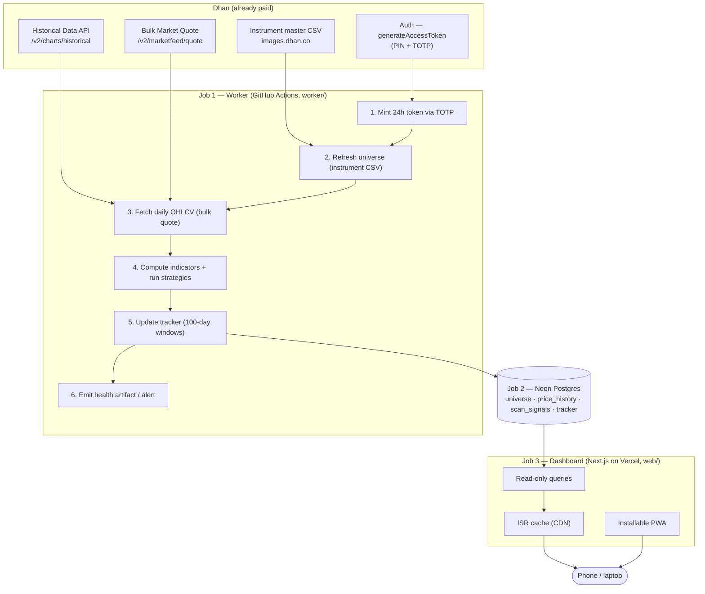

# 01 — Architecture

## The core idea: three decoupled jobs
The app is not one program. It is **three independent jobs** that only meet at the database. This separation is the spine of the design and is what makes it cheap and reliable.

| Job | Responsibility | Runs on | Triggered by |
|-----|----------------|---------|--------------|
| **1. Worker (scan)** | Pull data from Dhan, compute indicators, run strategies, update tracker, write results | GitHub Actions (`worker/`) | Cron, once each trading evening |
| **2. Store** | Hold the universe, price history, signals, and tracker state | Neon Postgres (free) | Read/written by the other two jobs |
| **3. Dashboard (UI)** | Show the tracker, hit rates, and per-strategy tables | Next.js on Vercel (`web/`) | Opening the site |

Why this matters: the worker can take minutes and hold secrets; the UI must be instant. Forcing them into one process (v1's mistake) couples a slow, credential-holding batch job to a web page. Splitting them means each runs on the platform built for it.

## System diagram



## Tech stack (locked)
| Layer | Choice | Why |
|-------|--------|-----|
| Language (worker) | Python 3.11+ | Reuse v1 logic; best data/indicator ecosystem (pandas, TA libs) |
| Worker host | GitHub Actions (cron) | Free, runs unattended, no PC needed; immune to NSE IP blocks (uses Dhan API) |
| Market data | Dhan API (+ official `dhanhq` SDK) | Reliable, official, already paid; no scraping |
| Database | Neon Postgres | Free, managed, scales to zero |
| Frontend | Next.js (App Router) | Industry-standard React framework, great on Vercel, strong mobile support |
| Styling | Tailwind CSS | Fast, mobile-first responsive design |
| Components | shadcn/ui | Professional tables/cards out of the box |
| Frontend host | Vercel (Hobby) | Free, global CDN, instant deploys, PWA support |
| Caching | Next.js ISR | The dashboard hits the CDN cache, never the DB directly |
| Scheduling | GitHub Actions cron | Free; EOD timing slack is irrelevant |
| Secrets | GitHub Actions Secrets / Vercel env vars | Encrypted; never in code |
| Tests | pytest (worker) + a CI integration test | Enforce "rows actually written" (v1's worst bug) |

## One private repo (monorepo)
Everything lives in a **single private** GitHub repo, `the-swing-trades`:

```
the-swing-trades/   (PRIVATE)
  worker/           Python scan + GitHub Actions workflow
  web/              Next.js dashboard
  Planning Pack/    these blueprints
```

- The repo is **private** because the stored Dhan secrets (Client ID, PIN, TOTP secret) can place trades. There is no public repo and no portfolio surface to protect — keeping the whole thing private is the simplest safe option, and private repos still get free GitHub Actions minutes.
- **GitHub Actions** runs `worker/` on a cron. **Vercel** deploys the `web/` subdirectory (set Vercel's Root Directory to `web/`). Both read/write the same Neon database; the worker writes, the web app only reads.

## Why Vercel is only the UI (the recurring question, settled)
Vercel runs **stateless serverless functions** — they spin up per request, die in seconds, and have a read-only filesystem. That is perfect for serving a dashboard and wrong for (a) a multi-minute scan and (b) permanent storage. So the scan lives on GitHub Actions and the data lives in Neon; Vercel only renders the read-only view. "The scan isn't on Vercel" and "the website is on Vercel" are both true because they are different jobs.

## Environments and where secrets live
| Secret / value | Lives in | Used by |
|----------------|----------|---------|
| Dhan Client ID, PIN, TOTP secret | GitHub Actions Secrets | Job 1 — token generation |
| Neon connection string (worker, read/write) | GitHub Actions Secrets | Job 1 — writes |
| Neon connection string (web, pooled/read) | Vercel env vars | Job 3 — reads |
| Failure-alert webhook (Telegram/email) | GitHub Actions Secrets | Job 1 — watchdog |

No secret ever appears in source code or in the repo's tracked files; `.env` is git-ignored.
