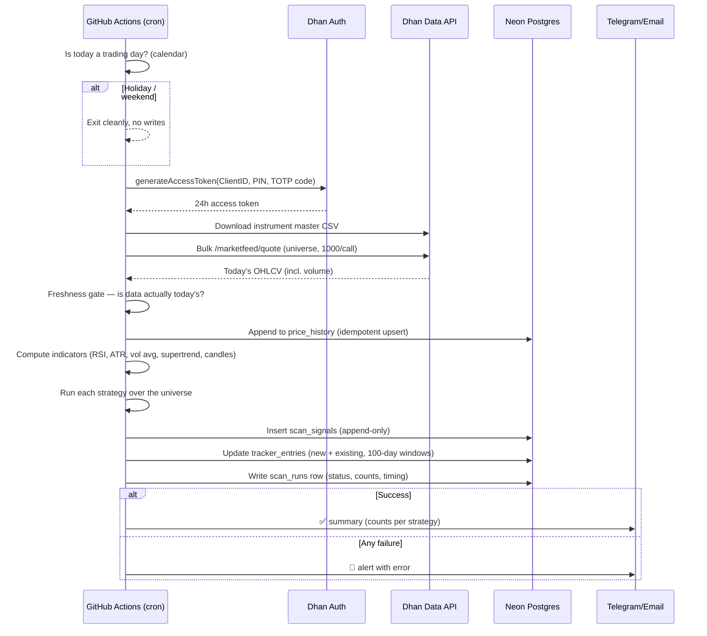
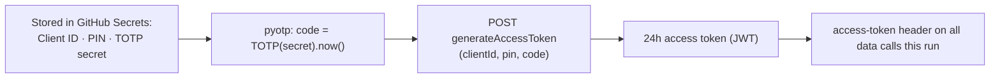
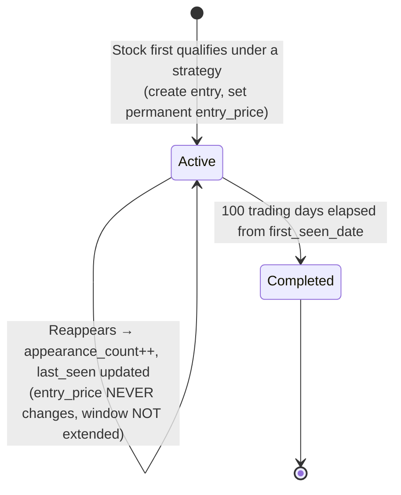
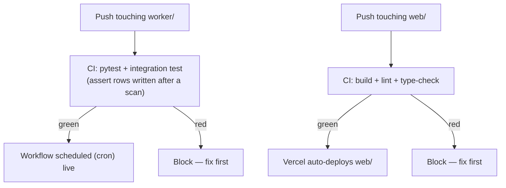

# 02 — Process Flows

Step-by-step flows for everything that happens, with diagrams. This is the "how it actually runs" document.

---

## Flow A — The nightly scan (the heartbeat)
Runs once per trading evening via GitHub Actions cron (~7:30 PM IST / 14:00 UTC, after the day's data settles). EOD timing slack is fine — even a 45-minute delay changes nothing.

**Plain-English steps**
1. **Trading-day check.** If today is a weekend or NSE holiday, exit cleanly — write nothing.
2. **Mint token.** Compute the current TOTP code from the stored secret, call Dhan, get a fresh 24-hour token.
3. **Refresh universe.** Download the instrument master CSV; filter to active NSE + BSE equities; upsert into `instruments`.
4. **Fetch prices.** Bulk-call `/marketfeed/quote` (≤1000 instruments per call → ~2–3 calls) to get today's open/high/low/close/**volume** for the whole universe.
5. **Freshness gate.** Verify the data is actually for today's trading date. If stale/empty → abort with an alert, do **not** write garbage.
6. **Store prices.** Upsert into `price_history` keyed on `(instrument, trade_date)` (idempotent — re-running can't double-insert).
7. **Compute indicators** from the trailing history (RSI-14, ATR-10, 14-day volume average, Supertrend, candle patterns).
8. **Run strategies.** Each strategy evaluates the universe and emits qualifying signals.
9. **Append signals** to `scan_signals` (immutable audit trail).
10. **Update tracker.** New qualifiers → new `tracker_entries`; already-tracked → increment `appearance_count`, update `last_seen`; entries past 100 trading days → mark `completed`.
11. **Record the run** in `scan_runs` (status, counts, timing).
12. **Always emit an artifact** — a success summary or a loud failure alert. A missing artifact is itself a red flag.

---

## Flow B — Token generation (TOTP, unattended)
Replaces v1's manual login. The token is 24h; TOTP lets the worker generate it itself.

1. Worker reads Client ID, PIN, and TOTP secret from GitHub Secrets.
2. It computes the current 6-digit TOTP code from the secret (same math as Google Authenticator).
3. It calls `generateAccessToken` with Client ID + PIN + code.
4. Dhan returns a fresh 24-hour token.
5. The token is used in the `access-token` header for that run's data calls, then discarded.

No human, no browser, no OTP typed. The 24h limit is irrelevant because the run finishes in minutes.

---

## Flow C — Tracker lifecycle (the 100-trading-day window)
One tracker entry per `(stock × strategy)`. The entry price is the EOD close on the first-seen date and is **permanent**.

**Rules enforced here (see 03_DATA_MODEL for the full list)**
- Entry price is fixed on day 1 and never overwritten.
- A reappearance does **not** reset or extend the 100-day clock — the window is measured strictly from `first_seen_date`.
- The window counts **trading days**, not calendar days.
- Same stock flagged by two strategies = two separate entries (keyed on stock × strategy), so each strategy's hit rate stays honest.

---

## Flow D — Opening the dashboard (why it's instant + free)
The browser never touches the database directly. It hits a cached page on Vercel's CDN.

1. Opening the site → served a pre-rendered page instantly from the CDN.
2. The page revalidates on a schedule (e.g., once an hour, or after the nightly scan). Regeneration happens **in the background**, not while you wait.
3. Only regeneration touches Neon — via a pooled connection — so Neon's cold-start never blocks anyone.
4. Result: instant loads, near-zero DB load, no cost.

---

## Flow E — Deploy & CI (how changes go live)
One private repo, two CI paths selected by which folder changed.

1. **Worker (`worker/`):** every push runs `pytest` plus the **integration test** that asserts at least one row is written after a mocked scan — the literal fix for v1's "0-byte DB for a month" bug. Cron only runs from a green main.
2. **Web (`web/`):** every push builds, lints, and type-checks; Vercel auto-deploys the `web/` folder on green.
3. Secrets are injected at runtime from GitHub Secrets / Vercel env vars — never committed.
