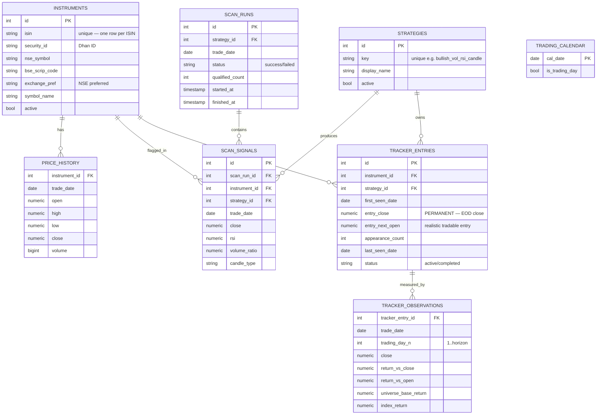

# 03 — Data Model (Postgres)

The database is the single source of truth shared by all three jobs. Schema is **idempotent** (safe to re-run) and synced on every worker startup. Below is the conceptual schema — exact column types are guidance for Claude Code, not law.

## ER diagram

## Tables in detail

### `instruments` (the universe / stocks master)
One row per **ISIN**. Built from Dhan's instrument master CSV.
- `isin` (unique), `security_id` (Dhan), `nse_symbol`, `bse_scrip_code`, `exchange_pref`, `segment`, `symbol_name`, `series`, `lot_size`, `asm_gsm_flag`, `active`.
- **Rule #4 lives here:** when a stock is dual-listed, the NSE variant is canonical (`exchange_pref = 'NSE'`); the BSE scrip code is stored on the same row for reference.

### `strategies`
Registry of screening strategies. `key` (unique), `display_name`, `description`, `active`. Parameters live in `config/strategies.yaml` (tweak without code change), not hard-coded.

### `price_history` (daily OHLCV)
The accumulated daily candles that feed indicators. One row per `(instrument_id, trade_date)` — **unique constraint** → idempotent upserts. Backfilled once from Dhan's Historical Data API, then appended each evening from the bulk quote. This is the mutable price table (corrections allowed); it replaces v1's `price_snapshots` (no live intraday in v2).

### `scan_runs`
One row per `(strategy_id, trade_date)`. Tracks `status` (success/failed), `qualified_count`, `started_at`, `finished_at`, `error`. The operational record of each night's run.

### `scan_signals` — APPEND-ONLY
The immutable audit trail. One row per `(scan_run, instrument)` that qualified, with a snapshot of the metrics that made it qualify (`close`, `rsi`, `volume_ratio`, `candle_type`, etc.). **Never UPDATE or DELETE rows here** — this is the evidence base for hit-rate claims.

### `tracker_entries` — the heart of the tool
One row per `(instrument_id, strategy_id)` — **unique constraint** (Rule #2). Holds `first_seen_date`, **`entry_close`** (EOD close on first-seen date — permanent, Rule #3) **and `entry_next_open`** (next trading day's open — the realistic, tradable entry; see 05_STRATEGIES §3), `appearance_count`, `last_seen_date`, `status` (active/completed). The tracking window is `tracking_horizon_days` trading days (default 100) measured strictly from `first_seen_date` (Rule #8).

### `tracker_observations` (the performance curve + benchmarks)
One row per `(tracker_entry, trade_date)` giving `trading_day_n`, `close`, `return_vs_close`, `return_vs_open`, and — for edge measurement — `universe_base_return` (the universe's average return over the same window) and `index_return` (Nifty over the same window). Powers the per-entry chart and all edge metrics. Derivable from `price_history` + `tracker_entries`.

### `strategy_metrics` (aggregated edge view)
Per `(strategy_id, horizon)`: `sample_size`, `hit_rate`, `base_rate`, `excess_hit_rate`, `avg_win`, `avg_loss`, `expectancy`, `median_return`, `hit_rate_at_5pct`, `hit_rate_at_10pct`, `avg_days_held` — computed against **both** entry references. This is what the dashboard's per-strategy efficiency band reads from. (See 05_STRATEGIES for the methodology.)

### `trading_calendar`
`cal_date`, `is_trading_day`. Static NSE holiday list reviewed annually (Rule #7). Drives the trading-day check and the 100-trading-day counting.

## The 8 architecture rules → where each is enforced
| # | Rule | Enforced by |
|---|------|-------------|
| 1 | Scan and dashboard decoupled | Separate jobs/repos; UI is read-only |
| 2 | Tracker keyed on (stock × strategy) | `tracker_entries` unique(instrument_id, strategy_id) |
| 3 | Entry price permanent | `entry_price` set on insert, never updated; reappearance only `appearance_count++` |
| 4 | NSE preferred when dual-listed by ISIN | `instruments.exchange_pref`; BSE scrip stored alongside |
| 5 | `scan_signals` append-only | No UPDATE/DELETE; insert-only access pattern |
| 6 | One mutable price table | `price_history` is mutable; `scan_signals` is not |
| 7 | All times IST; static holiday list | `trading_calendar`; timestamps stored/handled in Asia/Kolkata |
| 8 | 100 **trading**-day window, not extended | Counted via `trading_calendar` from `first_seen_date`; reappearance never resets |

## Idempotency & integrity (build-time requirements)
- Unique constraints on `price_history(instrument_id, trade_date)` and `tracker_entries(instrument_id, strategy_id)` so re-running a scan can never double-insert.
- `scan_signals` insert-only.
- Schema + strategy-registry sync run on every worker startup (auto-initialize) so nothing manual is ever required.
- Use Neon's **pooled** connection string from the web app to avoid connection exhaustion.

## Backtest readiness (for the deferred v2.1)
The schema is designed so a point-in-time historical backtest can be added without rework: `price_history` already holds full daily OHLCV per instrument, and `instruments` should retain delisted/inactive rows (mark `active=false` rather than deleting) so a backtest can reconstruct the **point-in-time universe** and avoid survivorship bias. No backtest engine is built in v2.0 — this only keeps the door open.
